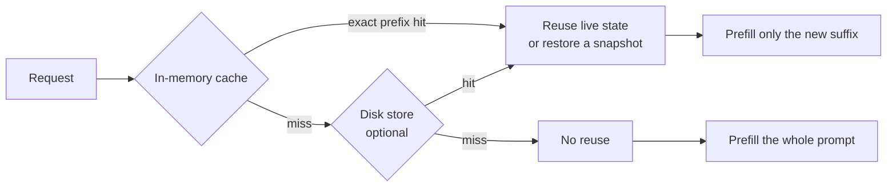
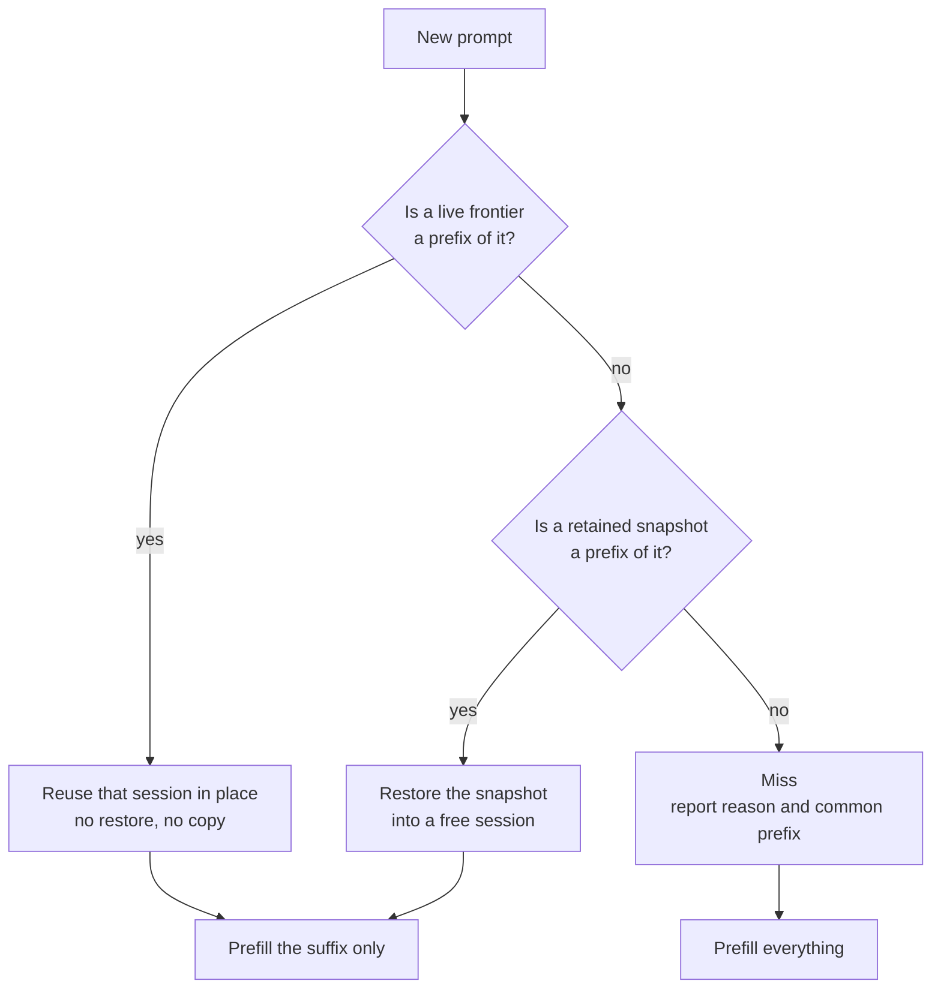
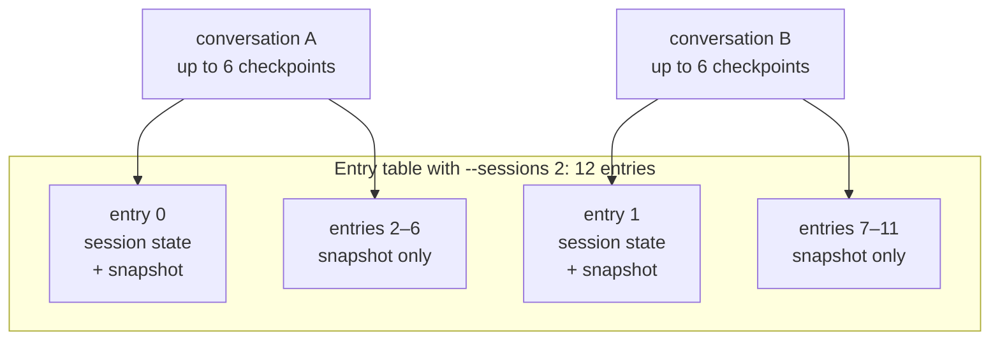

# KV Cache

## What "KV cache" means here

Two different things share the name. Keeping them apart avoids most of the
confusion.

**Within one request.** The standard transformer mechanism. Prefill computes
key and value tensors for every prompt token once; decode then appends one K/V
pair per generated token and attends over the stored set. Without it, each new
token would re-run attention across the whole sequence. This is intrinsic to
inference and is not configurable.

**Across requests.** Keeping that state alive after a response finishes, so
the next turn of the same conversation does not recompute the prefix it shares
with the previous one. This is what the rest of this document is about: the
`ContinuationCache`, and the optional on-disk tier behind `--cache-disk`.

The second is where the important subtlety lives. What Gufo retains is **not**
literally K/V tensors. It is an opaque snapshot owned by the model runner. For
Qwen3.8-27B that payload happens to be attention KV. For Qwen3.8-Flash-Next it
also contains GDN recurrent state, the indexer, position and sampling state.
The cache cannot inspect or interpret those bytes.

That choice buys one retention, admission, eviction and persistence mechanism
that is correct for every model, including hybrid-recurrent ones. It costs the
ability to trim a checkpoint: a saved snapshot can only be reused **whole**,
and only when its tokens are an exact prefix of the new prompt.

### Flash-Next checkpoint capture

Flash-Next host snapshots share immutable attention K/V and completed indexer
block keys with the preceding retained checkpoint. Capture copies only their
new suffix (including a partial block crossed by a rewind), plus all mutable
recurrent, convolution, raw-indexer and predictor frontier state. Sharing follows device-state provenance: reset and raw disk
restore clear it; native snapshot restore establishes it; writes after a rewind
invalidate the overwritten suffix. Matching token strings alone never establish
sharing.

Each checkpoint owns references to independent host blocks and survives source
session reuse or destruction. The session keeps only a weak checkpoint reference,
so eviction can release it. Immutable blocks are at most 1 MiB. Sharing retains
whole blocks; a rewind recopies the crossed partial block instead of retaining unused ancestor tails.
Queued copies complete before capture publishes a checkpoint, including when
cancellation interrupts capture.

The persistent payload remains complete. Version 17 rejects older Flash-Next
checkpoints computed before the MTP catch-up attention boundary correction;
version 18 adds the MTP draft-stop policies' learned state, so a restored
sampled continuation drafts as the original would have. Version 19 also saves
the low-acceptance recovery probe position for deterministic greedy continuation.
Native restore reads the blocks directly; disk export streams them in payload order without
a contiguous temporary. `CopyTo` writes into caller-owned contiguous storage.
Requesting the model diagnostic's `bytes()` view materializes and retains a contiguous copy lazily. First captures and captures whose preceding
checkpoint has expired still copy the complete device state. GPU restore also
still transfers the complete state. Admission and `cache_snapshot_bytes` continue
to count logical payload bytes conservatively, including shared prefixes.
See the [implementation and validation record](plans/flash-next-host-snapshots.md).

## Why it exists

Prefill cost scales with prompt length. Decode cost scales with tokens
generated. Agent conversations have a large prompt and a small output, and
turn *N*'s prompt is nearly all of turn *N−1*'s prompt. Without cross-request
reuse, every turn pays for the whole conversation again and total cost grows
quadratically with conversation length.

What reuse is worth, same conversation, second turn against a cold start
**(measured)**:

| Model | Prompt | Cold | Reused |
| --- | ---: | ---: | ---: |
| Qwen3.8-27B | 101,545 | 280.4 s | 2.4 s |
| Qwen3.8-Flash-Next | 203,047 | 184.4 s | 0.7 s |

A recorded 28-turn `pi` coding session reused 95.9% of its prompt tokens. The
same session replayed with reuse broken reprocessed 9.3x the tokens and took
2.5x the wall time, at only 15k tokens **(measured)**.

## The shape of the system



The in-memory tier is always on. The disk tier is opt-in, adds restart safety,
and can additionally *learn* boundaries between conversations that merely share
a prefix.

## Finding reuse

A request arrives with a token sequence. The cache looks for the longest
retained prefix of it, in two different forms.



A **live frontier** is where a session's state actually ended up after its last
request, including the tokens it generated. It is preferred even when a
snapshot matches the same length, because the state is already sitting there:
no restore and no device copy. This is why continuing the previous turn of a
conversation is nearly free, and why reuse can cover generated tokens and not
just prompt tokens.

When a request needs a state for restoration or a cold start, the cache prefers
an idle state without a live frontier. It chooses the least recently used state
within that group, falling back to the least recently used idle state with a
frontier when necessary. This preserves generated replies for later turns when
spare states exist; it does not reserve a state for each conversation.

A **snapshot** is an immutable retained checkpoint. Reusing one means restoring
it into a session, which costs a copy.

Both require an **exact prefix match**. The cache still computes the longest
common prefix on a miss and reports it, which is why a miss can say "we agreed
on 7,094 of your 7,103 tokens" and still re-prefill everything: it had no
checkpoint at that position to resume from.

### Worked example

A conversation with a 5,000-token system prompt, thinking off, client replaying
the assistant turn verbatim:

| Turn | Prompt | Reused | Prefilled | Why |
| --- | ---: | ---: | ---: | --- |
| 1 | 5,020 | 0 | 5,020 | nothing retained yet |
| 2 | 5,320 | 5,020 | 300 | live frontier from turn 1 |
| 3 | 5,620 | 5,320 | 300 | live frontier from turn 2 |

Now change one thing: edit the *last user message* of turn 3 and resend. The
first 5,320 tokens are byte-identical. The longest usable retained checkpoint
wins, which can be the previous turn's frontier. If the longest usable
checkpoint is instead the intermediate position at 4,096 tokens, that prefix
can be restored and only the suffix is prefilled. If earlier checkpoints have
been evicted or refused by the byte budget,
and all remaining checkpoints fall after the edit, reuse is impossible:

| Turn | Prompt | Reused | Prefilled | Common prefix |
| --- | ---: | ---: | ---: | ---: |
| 3', intermediate checkpoint retained | 5,620 | 4,096 | 1,524 | 5,599 |
| 3', no usable earlier checkpoint | 5,620 | 0 | 5,620 | 5,599 |

That gap between "common prefix" and "reused" is the signature of the
exact-prefix limitation. See #331.

## What gets retained

The unit of retention is a **checkpoint**, not a conversation. A single request
can retain up to four intermediate checkpoints in addition to its branching
fallback and complete prompt. Prefill stops at those positions and captures the
whole model state before advancing. Positions lie on a 2,048-token grid spread
across the prompt; the final grid point is within 2,048 tokens of its end.
Warm continuations capture only positions beyond the reused frontier. They
also retain their stable boundary before mutable assistant framing, preserving
reuse when a client drops reasoning from the next history replay. Admission
remains subject to the existing byte budget, and intermediate copies preserve
the original branching fallback. These intermediate checkpoints live in RAM;
the disk tier continues to retain prompt and learned shared-prefix boundaries.

The entry table holds `sessions x 6` entries. The first `sessions` of them own
a real session state and are the only ones a request can execute in; the rest
exist purely to hold snapshots.



Six entries allow a long conversation to retain all four intermediate positions
and endpoint checkpoints without allocating more execution sessions. Warm
turns with a separate stable boundary share these six slots with intermediate
positions; admission can evict an older checkpoint.
This is an entry limit, not a guaranteed conversation count: checkpoint sizes,
byte admission and global eviction also determine how much history remains
resumable. Workloads with more retained histories than entries can still lose
reuse under round-robin traffic. See #341.

When entries are full, an edited branch prefers replacing an incompatible
checkpoint after its reused prefix over evicting an earlier shared checkpoint.
Other entry eviction and byte-budget admission still use age order. Saving a
warm turn's newer boundary also preserves its original resume point during
admission, so optional copies cannot immediately displace that fallback.

The limit is reported at startup:

```text
event=snapshot_cache_configured sessions=2 snapshot_entries=12 capacity_bytes=99007139840
```

## Invariants

These constraints are why several design choices are not preferences. Change
them deliberately or not at all.

**A snapshot can only be captured where the state actually sits.** The runner
serialises the state as it is; there is no way to capture position *N* while
the state is at *M*. Retaining a checkpoint at a stable boundary therefore
requires prefill to **stop** at that boundary. A warm continuation cannot both
reuse a frontier and retain its own boundary in a single uninterrupted pass.

**The reused frontier must be frozen before prefill.** Prefill mutates the
leased state in place, so a frontier another request might branch from has to
be captured first.

**Admission is advisory, never fatal.** A refused reservation or a failed
capture is a skipped optimisation. The request must still complete.

**Eviction cannot skip a victim.** If removing an entry fails, the eviction
loop stops rather than trying the next candidate, in both tiers **(source)**.

## Limits

Three budgets, each able to bind first.

| Limit | Default | Set by |
| --- | --- | --- |
| Retained snapshot bytes, RAM | `MemAvailable / 2` | `--cache-ram-bytes` (0 = auto; positive values replace the cap) |
| Disk bytes | 8 GiB | `--cache-disk-bytes` |
| Disk staging bytes | smaller of `MemAvailable / 8` and the disk budget | `--cache-disk-staging-bytes` |

An explicit RAM cap replaces the model's automatic budget and may exceed it;
values above it log a warning, since Gufo does not verify the RAM exists. It
limits logical retained payload bytes conservatively,
including shared prefixes, rather than total process committed memory. Live
state, weights, disk staging and temporary save buffers remain separate.
Snapshot format and disk files are unchanged. Returning the option to zero
restores automatic sizing on the next launch.

The RAM budget is sampled **after** the model and sessions are allocated, then
halved. It therefore shrinks as `--context` and `--sessions` grow, which is
exactly when snapshots are largest. On Flash-Next at 262144 context a single
snapshot reached 5.70 GB against a 7.76 GB budget, so a second could not be
retained **(measured)**. See #343.

Snapshot size scales with retained tokens and differs sharply between models:
roughly 0.5 GB at 5k tokens on Flash-Next, and 3.7 GB at 24k tokens on
Qwen3.8-27B **(measured)**. Automatic disk staging has no fixed 1 GiB cap:
it follows available RAM and the disk budget, allowing larger checkpoints
when both budgets permit. See #259.

Snapshot eviction is least-recently-used in both tiers, with no awareness of
conversation, prefix depth or rebuild cost.

## The disk tier

`--cache-disk DIR` adds a second tier that survives restarts. A checkpoint
written before a restart restored a 24,866-token prompt in 1.8 s against about
50 s for a cold prefill **(measured)**.

It also does something the memory tier cannot: it **learns shared-prefix
boundaries**. When several prompts share a long prefix and then diverge, it can
capture a checkpoint at the divergence point so later conversations resume from
it. This is why a system prompt shared across separate conversations is
reusable with `--cache-disk` and not without. The boundary is not learned on
first sight; in one run it became usable from the fifth conversation
**(measured)**. See #267.

**Disk checkpoints are spaced at least 2048 tokens apart.** A conversation
advances a few hundred tokens per turn, so writing every turn serialises, fsyncs
and retains a nearly identical snapshot. A checkpoint less than 2048 tokens past
the longest stored entry that is still a prefix of it is skipped and logged as
`min_step`; the RAM tier still retains it. When RAM does not retain it either,
the device state is not copied at all, so a skipped checkpoint costs no capture
time on the request path. Learned shared-prefix boundaries are
exempt, because they sit close to a deeper entry by construction. On a
Qwen3.8-27B functional run this cut disk writes from 31 to 5 and written bytes
from 6.97 GiB to 1.37 GiB **(measured)**. Ported from upstream #348; see
upstream #492 for the write-volume report.

The trade-off is what a disk-only restore resumes from. After a restart, or
once RAM evicted the conversation, a request restores the nearest stored entry
and re-prefills up to 2048 tokens plus its own turn, instead of resuming
exactly at the previous frontier. The re-prefilled gap follows different chunk
shapes, as with any partial hit, so sampled output can differ from the
pre-restart response. Greedy output can differ too where prefill is not exact
at every chunk shape: on Qwen3.8 Flash-Next, past 2048 tokens, sparse
attention packs four queries at absolute multiples of four, and a chunk
boundary inside such a group changes which keys the group reads. Boundaries
at multiples of four are exact. A teacher-forced wikitext slice whose chunks
all start one past a multiple of four changed top-1 on 12 of 530 such
positions between 8-token and 1-token chunks **(measured)**. Plain continuation from RAM
is unaffected.

Disk entries are evicted by global LRU on last access, so one active run whose
checkpoints are all recent will displace every other conversation in age order
**(measured)**. See #275.

## What invalidates reuse

Anything that changes the token prefix. In practice:

- **Tool definitions** — adding, removing or reordering changes the prompt head
  and invalidates everything after it.
- **System prompt** — including anything volatile inside it, such as a
  timestamp or a working directory.
- **Response schema** — `response_format` is rendered into the prompt.
- **Images** — changing, removing or moving an earlier image invalidates
  checkpoints after it. Appending a new one does not.
- **Reasoning the client cannot replay** — thinking is on by default for Qwen
  and `reasoning_content` is not part of the OpenAI schema, so an ordinary
  client omits it when sending the conversation back. Gufo retains each turn's
  boundary before the assistant opening, so the next turn can reuse the prior
  history and process the rewritten assistant plus new input. That boundary
  must be saved on warm hits too; retaining only the old resume point caused
  cache reuse to stop advancing for the rest of the session. See #335.

These do **not** invalidate reuse **(measured)**: changing `temperature`,
`top_p`, `seed`, `max_tokens`, penalties or `stop` between turns; streaming
versus not, which reuse identically and interoperate within one conversation.

`cache_prompt: false` on `/v1/chat/completions`, `/v1/responses`,
`/v1/completions` or `/completion` bypasses lookup for a single request.
Omitted or `null` keeps the default, `true`. The result can still populate
the cache.

## Observing it

| Log line | Meaning |
| --- | --- |
| `event=snapshot_cache_configured` | retained capacity, at startup |
| `event=snapshot action=removed reason=entry_capacity` | a retained prefix was evicted because every entry was taken |
| `event=snapshot action=skipped reason=byte_capacity` | a checkpoint did not fit the RAM budget |
| `event=disk_cache action=removed reason=lru` | a disk entry was evicted to stay inside `--cache-disk-bytes` |
| `event=disk_cache action=skipped reason=staging_capacity` | a checkpoint exceeded `--cache-disk-staging-bytes` and was never written |
| `event=disk_cache action=skipped reason=min_step` | a checkpoint was less than 2048 tokens past a stored prefix; RAM still retains it |

Per-request outcomes appear in the completion log and in `usage.gufo`:
`cache_hit`, `cache_miss_reason`, `cache_common_prefix_tokens`,
`cache_checkpoint_tokens`, `cache_restore_bytes`, `cache_restore_ms`, plus
`prompt_n` (newly processed) and `cache_n` (reused) in the llama.cpp-compatible
`timings` object. Miss reasons are `no_checkpoint`, `prefix_changed`,
`input_changed` and `disabled`.

Reading them:

- `cache_n` growing turn over turn while `prompt_n` stays flat is healthy
  reuse.
- `cache_n` **pinned** at the same value while `prompt_n` grows every turn is a
  checkpoint that stopped advancing. See #335.
- A large `cache_common_prefix_tokens` on a miss means a long prefix agreed and
  could not be resumed from: a mid-history edit, or an evicted checkpoint.

## Verifying changes

- `tools/serving/check-continuation.py` covers cancellation, reasoning replay,
  images and restart persistence against a live server.
- `tests/cli/continuation_cache_test.cpp`,
  `tests/cli/continuation_disk_store_test.cpp` and
  `tests/cli/text_model_runner_test.cpp` cover retention, admission, eviction
  and the event sinks without loading a model.

## Known gaps

Tracked under #336, with the upstream reports #331, #335, #259, #267, #275,
#300 and #318.
